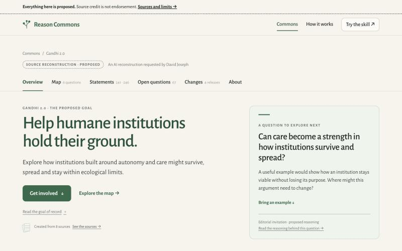
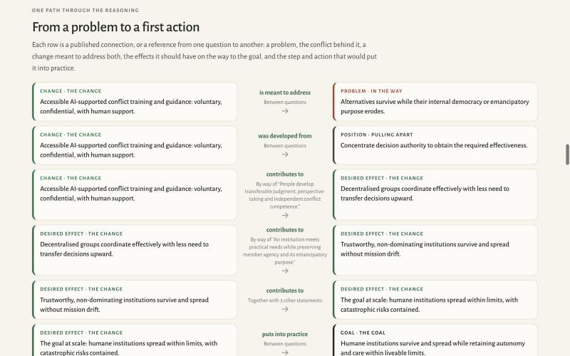
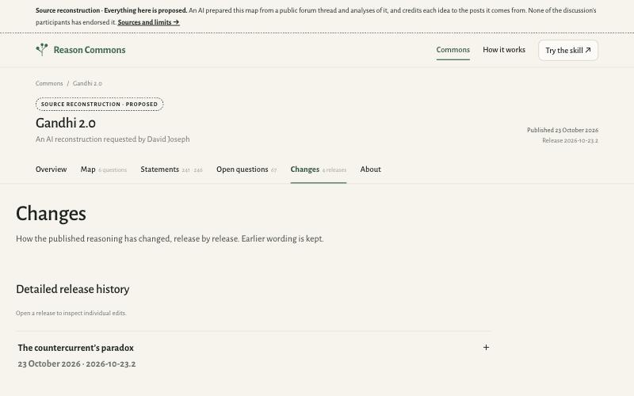
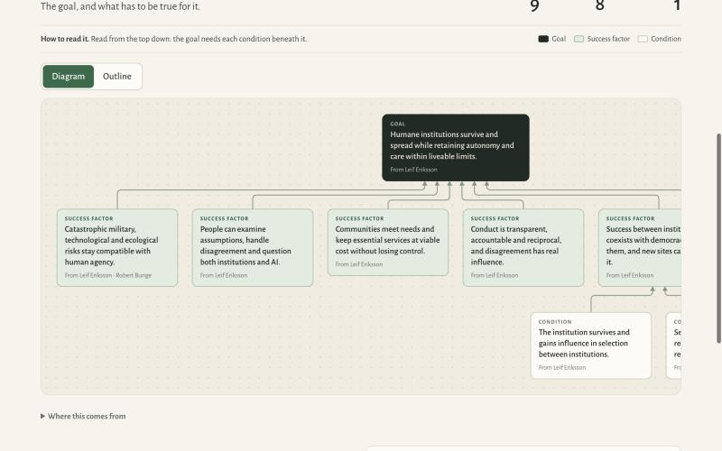
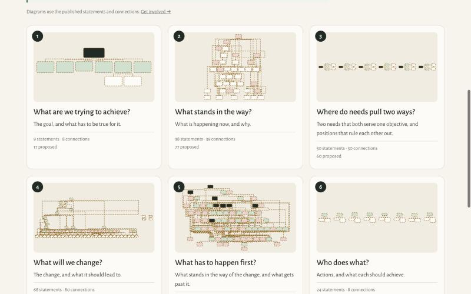
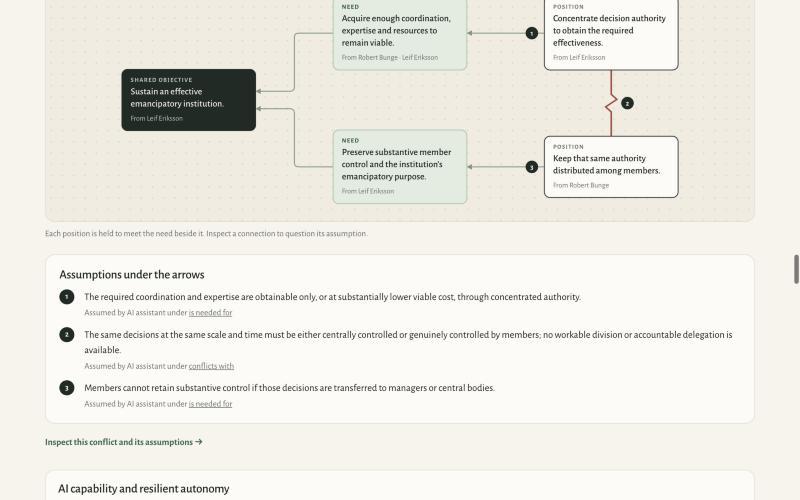
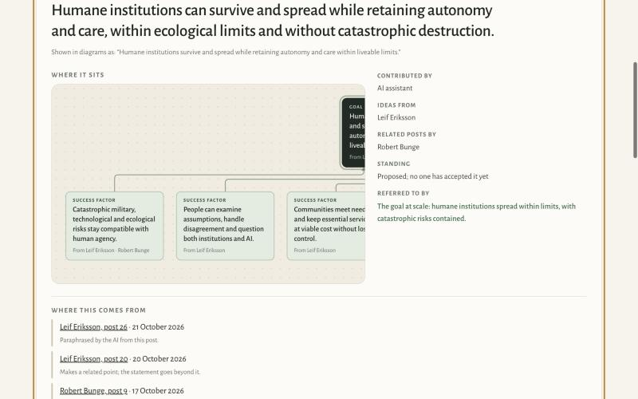
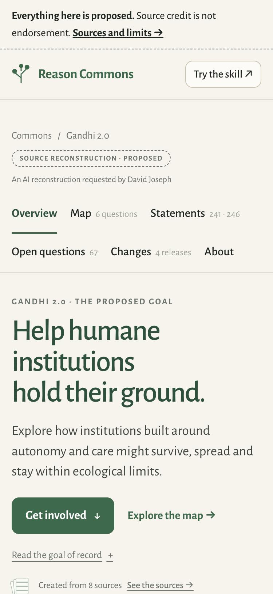
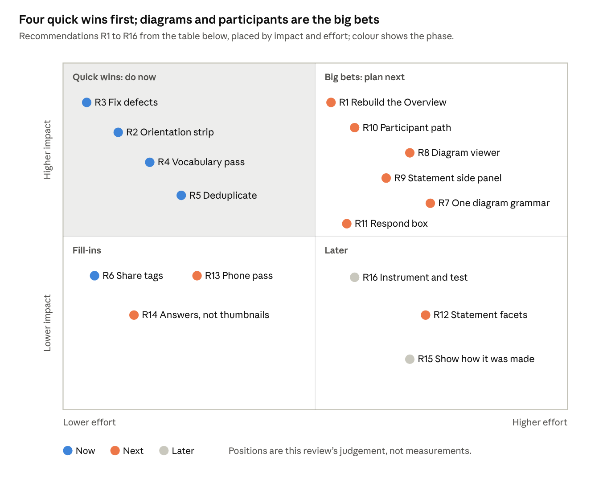
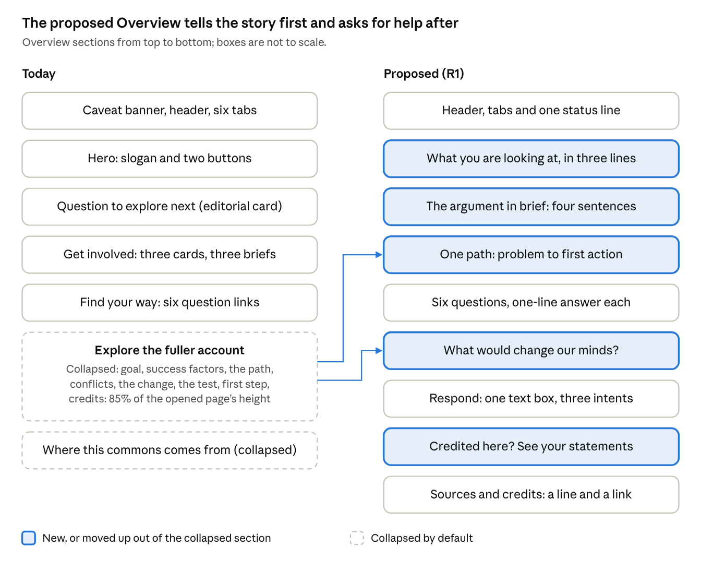

# Gandhi 2.0 demo — UX evaluation & critique

25 October 2026 · David Joseph, with Claude

A review of the [Gandhi 2.0 demo commons](https://reasoncommons.com/demos/reason-commons-in-use/gandhi-2-0/index.html) (release 2026-10-23.2) and every view reachable from it.

## Executive summary

Gandhi 2.0 earns trust better than any public reasoning record I know, but it does not yet earn attention. A first-time visitor meets a careful archive, not a product doing something remarkable. The craft is high and the provenance model is best-in-class; the problems are structural, because the front door, the diagrams, the vocabulary and the contribution path were designed from the builder's side of the glass.

**What matters most**

1. **The story is folded away.** Collapsed, the Overview is 1,842 px tall at 1280 px wide; opened, it is 12,654 px. The success factors, the problem-to-action path, the conflicts, the test and the first step all sit inside one accordion labelled "Explore the fuller account".
2. **A cold visitor gets no orientation.** None of the 12 commons pages explains the name "Gandhi 2.0", what a commons is, or how to read one. That framing lives one level up on the Commons hub, which a shared link skips.
3. **Six views, four reading directions.** Goal and First steps read top-down; In the way, Change and Actions read bottom-up; Conflict reads right-to-left. Each page re-teaches its own legend.
4. **Diagrams outgrow the page.** At 1280 px the 9-box goal tree is 1,450 px wide and one First-steps diagram is 3,150 px. Several also scroll vertically inside the page, so the mouse wheel gets captured mid-read.
5. **The vocabulary is the method's, not the reader's.** 19 statement types share 6 colours. "Change" names a release log, a question and a statement type; "question" names the six questions, 67 work items and an editorial prompt.
6. **Contributing needs an AI or a GitHub account.** Every route copies a \~2,000-character brief into your own AI or opens a GitHub issue. The three people whose posts are paraphrased have no direct "that is not what I said" path.
7. **The Statements view is heavy.** It ships 4.6 MB of HTML (252 KB compressed) and 58,746 elements, and every box clicked in any diagram loads it.

**Scorecard**

| Dimension | Rating | In one line |
| --- | --- | --- |
| Trust and provenance | Excellent | Every statement links to the post it draws on and says how faithfully it paraphrases it. |
| Visual craft | Strong | Calm editorial type and palette, consistent cards, and one excellent diagram: the conflict cloud. |
| Content and narrative | Adequate | Precise but heavily hedged; the argument is never told in plain words up front. |
| Information architecture | Weak | Sound top-level tabs; duplicated content, hidden content and overloaded labels underneath. |
| Onboarding a first-time visitor | Poor | No "what is this, why it matters, how to read it" on the commons itself. |
| Diagram usability | Weak | Wide canvases, nested scroll, shifting reading direction, no fit or zoom. |
| Contribution path | Weak | Thoughtful briefs, but indirect and gated. |
| Accessibility | Adequate | Good basics (skip link, focus styles, outline views); contrast and diagram naming gaps. |
| Performance | Adequate | Static and light, except Statements (4.6 MB) and About (793 KB). |

**If you only do three things**

1. Rebuild the Overview as a two-minute guided read: what this is, the argument in one paragraph, the problem-to-action path as one vertical chain, then the six questions.
2. Give every diagram one grammar: goal at the top, fit-to-width by default, pan and zoom on demand, no inner vertical scroll.
3. Add a participant path: "Are you Leif, Robert or Justin? See every statement credited to you and flag a paraphrase in one click."

## What the page is, and who it is for

Gandhi 2.0 is a demo commons: an AI's proposed reconstruction of one Second Renaissance Forum thread, five essays shared in it and two supplied analyses, mapped with the Logical Thinking Process into 241 statements and 246 connections. It sits inside "Reason Commons in use", a static demo microsite. Its real product job is to make a visitor think "I want my group's thinking to look like this."

**Who arrives, and what they need in the first minute**

| Visitor | Likely entry | Job in the first minute | What the page gives them today |
| --- | --- | --- | --- |
| Thread participants (Leif Eriksson, Robert Bunge, Justin) | Link posted back in the forum | Check how their posts were paraphrased; fix what is wrong | A credits table with counts but no links to their statements; name search works but is never suggested |
| Forum readers | The same forum link | Get the argument in plain words; decide whether to read on | A slogan headline and a question card; the argument itself is collapsed |
| Prospective Reason Commons users | Demo hub, How it works, a pitch | See what the product produces and picture their own group using it | Nothing on this page explains the method or the commons format |
| Contributors | "Get involved" | Add an example, a challenge or a correction with little effort | A brief to paste into an AI, or a pre-filled GitHub issue |
| The team (David Joseph, Rufus Pollock) | Demos and sharing | Show depth and integrity, and a quick "wow" | Depth and integrity, yes; the 60-second "wow", not yet |

The fit problem in one line: the page answers the integrity questions of the last two rows exhaustively, while most visitors will be in the first three.

**Every view reachable from it**

| View | File | What it holds | Height at 1280 px | HTML |
| --- | --- | --- | --- | --- |
| Overview | index.html | Hero, contribution cards, six-question index, then two accordions holding the story and the sources | 1,842 px closed; 12,654 px open | 169 KB |
| Map | map.html | The goal, six question cards with thumbnail maps, colour key | 1,976 px | 118 KB |
| 1 · What are we trying to achieve? | goal.html | Goal tree: 1 goal, 6 success factors, 2 conditions | 1,701 px | 19 KB |
| 2 · What stands in the way? | in-the-way.html | 6 current-reality parts, each a diagram or outline | 8,497 px | 214 KB |
| 3 · Where do needs pull two ways? | conflict.html | 6 conflict clouds with numbered assumptions | 7,104 px | 77 KB |
| 4 · What will we change? | change.html | 10 future-reality parts, including risks and alternatives | 10,542 px | 319 KB |
| 5 · What has to happen first? | prerequisites.html | 8 prerequisite trees | 11,928 px | 330 KB |
| 6 · Who does what? | actions.html | 8 actions, each a three-box diagram | 7,064 px | 60 KB |
| Statements | items.html | 487 cards (statements and connections) with search; each card's detail view lives in the same file | 45,438 px | 4,599 KB |
| Open questions | questions.html | 70 questions on 67 items, in four columns | 10,171 px | 48 KB |
| Changes | changes.html | 4 releases, each expandable to its edits | 1,567 px closed | 52 KB |
| About | about.html | Record summary, sources (twice), limits, release counts, credits, people, JSON link | 4,656 px | 793 KB |

One hop out: the Commons hub and How it works (the only places the format is explained), the main site's Skills, Explainers, Method, About and Demos pages, 8 source links, forum posts and three GitHub issue templates.

## Information architecture and navigation

The top level is sound: six tabs separate reading (Overview, Map, Statements), work (Open questions) and the record (Changes, About). Underneath, the structure leaks. The same objects live in up to three places, the most explanatory content is hidden, and key labels carry two or three meanings.

1. **The Overview is three pages stacked, and the useful one is hidden.** It is a landing page (hero and CTAs), then a contribution page (three cards with briefs), then a full report. The report is inside two accordions holding 85% of the opened page's height (10,812 of 12,654 px). *Fix:* make the story the page; put contribution after it, where the reader has a reason to contribute.
2. **Content is duplicated across views.** The 8 sources appear on the Overview, then twice on About (as cards, then as an accordion of the same 8). The credits table appears on Overview and About, and About adds a near-identical "People" table. The six conflicts appear in full on both Overview and Conflict. *Fix:* one canonical home per object; elsewhere, a one-line summary and a link.
3. **Labels collide.** The words the reader most needs to trust shift meaning between pages (table below). *Fix:* rename the Changes tab to "History"; call the Overview prompt "Where to start"; drop the question short-names from card eyebrows.
4. **The Map has no internal navigation.** Question pages keep "Map" highlighted and offer previous and next links, which is good. But there is no 1-to-6 stepper, and long pages have no index: Change runs 10 parts over 10,542 px with "Part 3 of 10" labels that link nowhere. *Fix:* a sticky question stepper plus a part index on pages with more than three parts.
5. **Clicking a box leaves the question.** Every node on every diagram navigates to the Statements tab, moving the tab highlight and loading the 4.6 MB file. The way back is the browser's Back button or a small text link. *Fix:* open the statement in a side panel on the question page; keep the deep link for sharing.
6. **Two homes, and the demo is unmarked.** The logo and breadcrumb go to the demo hub; the footer's "Back to the main site" goes to the root; "Try the skill" jumps to the main site. Visitors learn they are in a demo only from a footer line. *Fix:* a "Demo" marker beside the logo and one home link.
7. **The header changes between tabs.** Overview and Map show a breadcrumb and badge only. The other ten views add the title, publication date and release ID. The top banner is one line on the Overview and a two-line paragraph elsewhere. *Fix:* one header, everywhere.
8. **Statements cannot be filtered.** 487 cards (statements and connections mixed) are listed in question order with free-text search only. There are no filters by type, person, question, standing or "has open question", and the credit counts on Overview and About are not links. *Fix:* facets, with every count linking to its filtered list.
9. **Open questions uses a board for a list.** Grouping by kind of work is a good idea. Laid out as four columns of 7, 15, 13 and 35 cards, the page runs 10,171 px, most of it one column. The tab says 67 (items) while the board holds 70 questions. *Fix:* one list with kind and question filters, and one unit in the count.

**Terms that carry more than one meaning**

| Term | Meanings a reader meets |
| --- | --- |
| Change | The Changes tab (release history); question 4, "What will we change?"; a statement type; the short name "The change" in eyebrows such as "Desired effect · The change" |
| Question | The six questions of the Map; 70 open questions (work items); "A question to explore next" (an editorial prompt); "Question 1 of 6" |
| Map | A tab whose page is titled "One goal, six questions"; the whole commons ("you do not need to agree with the whole map") |
| Statements | A tab counting statements and connections ("241 · 246") whose list mixes both as cards |
| Goal | "The proposed goal", "the goal of record", "the goal at scale" (a desired effect), and the hero slogan |

## Content, narrative and copy

The writing is precise and careful, and almost never wrong; that is the problem. Most paragraphs spend their first clause protecting the record before they say anything. What the thread argues, and why a reader should care, is never told in plain words.

1. **The argument has no plain telling.** No block answers "what does this map say?" in 100 words. The nearest, "From a conversation to a shared question", lists the map's contents (causes, six conflicts, eleven changes) instead of its claim. *Fix:* a four-sentence "The argument in brief" directly under the hero (an illustrative draft follows this list).
2. **The name is never explained.** "Gandhi 2.0" appears 20 times on the Overview and is defined on none of the 12 pages. Only an open question hints that it names Leif's programme. Cold readers may take it as a joke or a claim about Gandhi. *Fix:* one line under the title saying whose term it is and what it names.
3. **Caveats are repeated until they are invisible.** On the Overview, "proposed" appears 17 times and "endorse" 8 times; in the Statements file, 1,692 and 975 times. Banner, badge, subtitle, eyebrow, goal note and card footers all repeat it, which trains readers to skip it. *Fix:* say it once, prominently; let the dashed badge and dashed borders carry it after that; keep per-item standing on the detail view.
4. **The goal has four wordings.** The hero says "Help humane institutions hold their ground." The goal of record says they "can survive and spread while retaining autonomy and care, within ecological limits and without catastrophic destruction." Diagrams say "within liveable limits", and a desired effect calls itself "the goal at scale". *Fix:* one canonical sentence; any shorter form labelled as a shorter form.
5. **The slogan argues while the page abstains.** "Help humane institutions hold their ground" is an imperative cause, followed one line later by "none of the discussion's participants has endorsed it". It also drops "spread", the heart of the goal. The page's own meta description is the better headline: "What would let humane institutions spread without losing what makes them humane?"
6. **Working-file vocabulary reaches public pages.** Examples: "goal of record", "source reconstruction", "supplied analysis", "standing", "the Laboratory, Forge/model adaptation, Vocal Presence", "The PDF distinguishes … (D/S/R/X)", "analysis-v2: p. 25, E12–E14". *Fix:* a glossary popover on first use; move analyst codes into the source block of the detail view.
7. **The one path through the reasoning reads backwards.** "From a problem to a first action" starts with a Change, not a problem. Rows read "Change is meant to address Problem" and "The goal at scale puts into practice Goal", and each row repeats the previous row's right-hand card. *Fix:* one vertical chain, problem at the top and action at the end, each card once, verbs in reading order.
8. **Connection labels point the wrong way.** On the goal's page, each success factor is introduced with "Leads into · is needed for", though the success factors lead into the goal. *Fix:* "Needed for this" and "This is needed for" headings.
9. **The three contribution briefs are one brief.** Each is about 2,000 characters, identical except for its opening lines, and all three render in full in the Overview's markup. *Fix:* one brief with a three-way choice at the top.

**An illustrative "argument in brief"** (a sketch to show the register, to be checked against the record before use): "Leif Eriksson argues that humane institutions lose to less humane rivals because the pressures that decide which institutions survive reward concentration and control. Robert Bunge warns against making AI the fix. The map proposes one small first test: AI-supported conflict guidance that members of one willing institution can question and leave. If members settle disputes themselves, less authority has to move upward."

**Copy worth keeping as the house standard**

- "What would change our minds?" names the test, says why fewer complaints would not settle it, and states what a local success leaves open. It is the best section on the site.
- Provenance lines such as "Paraphrased by the AI from this post" and "Makes a related point; the statement goes beyond it" are a model for AI attribution.
- "Shown in diagrams as: …" on statement pages honestly discloses the short label.
- Questions as section titles ("What stands in the way?") make a formal method sound like conversation.

## Visual design and layout

After provenance, the visual language is the site's strongest asset. Warm paper, Alegreya Sans, a restrained green and index-card statements feel considered and humane, which suits the subject. The weaknesses are a colour code asked to carry too much, low-contrast metadata, decorative thumbnails, very long pages and a few layout bugs.

**What works**

- One card anatomy everywhere: type eyebrow, the statement, an attribution line. Learn it once, read 241 of them.
- Generous measure and line height in prose; headings phrased as questions give the long pages a conversational rhythm.
- The conflict cloud's red zigzag for "conflicts with" is legible before any label is read.

**What does not**

1. **Colour encodes families, not types.** The map key folds 19 statement types into 6 colours. One pale green means success factor, need, desired effect, expected effect and step. On cards, nearly every type gets the same green left border; only problems (red) and the goal (dark) differ. Readers must read every eyebrow. *Fix:* four visual roles (aim, obstacle or risk, change or action, context), with a small glyph for the type.
2. **Metadata fails contrast.** The tab counts (#9AA096 on cream, 13 px) measure 2.44:1 against the 4.5:1 AA minimum. Diagram boxes from other parts render at 50% opacity with 10–12 px grey text. Eyebrows are 10–11 px letterspaced capitals.
3. **Thumbnail maps decorate.** The Map page and "The wider picture" shrink whole diagrams to card size, where boxes are a few pixels and the First steps lines tangle. They say "this is big", not "this is what it says". *Fix:* replace with each question's one-line answer, or keep the thumbnail beside that line.
4. **Source "covers" cost space and need a disclaimer.** Eight faux covers share one generic icon, print each title twice (cover and caption) and stand at ragged heights. The page then explains "Document representations, not original covers". *Fix:* a plain list: title, author, kind, date, link, and how many statements draw on it.
5. **The Changes page breaks the grid.** At 1280 px its content starts about 40 px left of the header's left edge, on a narrower column.
6. **Diagrams are cropped without warning.** The 9-box goal tree is 1,450 px wide in a 1,134 px frame, so two success factors and a condition are cut at the right edge. On statement pages, "Where it sits" can crop the very statement it is about.
7. **Pages are long and uniform.** The opened Overview is 12,654 px, First steps 11,928 px, Statements 45,438 px. Hundreds of identical cards give no landmarks, progress or sense of place.
8. **The hero splits attention.** On desktop, the editorial question card carries the same weight as the goal beside it. On a phone, banner, header, breadcrumb, badge and two rows of tabs push the H1 to 432 px of an 812 px screen.

## Interaction design of the reasoning views

The diagrams are the product's signature, and the place the experience most needs work. Many are well drawn one at a time. As a system they change reading direction from page to page, overflow their frames, trap the scroll wheel, and send every click away from the question being read.

| View | "How to read it" (the page's own words) | Parts | Widest diagram measured (frame 1,134 px) |
| --- | --- | --- | --- |
| 1 · Goal | Top down | 1 | 1,450 px |
| 2 · In the way | Bottom up | 6 | 1,363 px (part 1) |
| 3 · Conflict | Right to left | 6 | Fits (cloud 1) |
| 4 · Change | Bottom up | 10 | 2,190 px (parts 6 and 7) |
| 5 · First steps | Top down | 8 | 3,150 px (part 7) |
| 6 · Actions | Bottom up | 8 | Fits (three boxes each) |

1. **Four reading directions in six views.** The trees follow the method's conventions faithfully, but a reader who moves from question 1 to 2 must flip their reading, then flip again at 3. *Fix:* normalise for display, not for the method: the aim always at the top (or left, for clouds), arrows always pointing toward it, and one identical "How to read it" line.
2. **Overflow without a cue, and scroll inside scroll.** Wide frames scroll sideways, a fact stated only in an aria-label. Several also scroll vertically inside the page: In the way part 1 holds 1,309 px in a 1,098 px frame, Change part 2 holds 1,619 px. With a mouse wheel, the page stops while the diagram moves. *Fix:* fit-to-width overview by default, click to open a full-screen pan-and-zoom view, edge fades on overflow, and never an inner vertical scroll.
3. **The Diagram/Outline switch looks local but acts global.** Each part has its own switch (6 to 10 per page). Clicking one changes only that part, yet it saves a site-wide preference that every part on every later page obeys. *Fix:* one sticky page-level switch whose state is visibly shared.
4. **Context boxes look disabled.** Boxes from other parts render at 50% opacity with grey text. In Change part 10, "How the changes reach the goal", all four inputs are muted, so the synthesis looks greyed out. *Fix:* full contrast, a dashed outline and a "from part 3" tag.
5. **Every box click leaves the page.** A click loads the 4.6 MB Statements file, switches the tab highlight to Statements, and breaks the reading flow. *Fix:* open the statement in a side panel over the diagram, with "open full page" for sharing.
6. **Outlines on phones nest until the text is a sliver.** Phones correctly default to the outline, but In the way becomes 23,647 px, about 29 screens, and each level indents further. *Fix:* collapse below the second level, add "expand all", and show a depth breadcrumb.
7. **Assumption labels read like code.** "Assumed by AI assistant under is needed for" sits under each numbered assumption. *Fix:* "Assumption behind arrow 1 · proposed by the AI".

**Interactions worth protecting**

- Hovering or focusing a box lights it and everything it touches, by mouse and by keyboard.
- The conflict cloud, with numbered arrows and its assumptions listed beneath, teaches the method in one screen; it is the best single view on the site.
- Statement pages answer every provenance question: where it sits, who contributed it, whose ideas, its standing, its sources with fidelity notes, connections, open questions, history and a brief.
- The statement filter updates a live count ("26 matching items") announced to screen readers.
- "Copy the brief" degrades gracefully: when the clipboard is blocked it opens and selects the text and says so.

## Accessibility, mobile and technical quality

The engineering foundations are better than most product sites: static HTML that reads fully without JavaScript, a 6 KB script, honest semantics and an outline alternative for every diagram. The gaps are contrast, how diagrams name themselves to assistive tech, phone navigation, and one very heavy page.

**Accessibility**

- **In place:** skip link; one H1 per page; labelled landmarks (site, breadcrumb, "this commons", further reading); a 3 px focus-visible outline, with its own treatment on diagram boxes; aria-pressed on the view switches; a live count on search; reduced-motion and print styles.
- **Contrast.** Tab counts measure 2.44:1 (AA needs 4.5:1). Context boxes in diagrams are drawn at 50% opacity.
- **Run-together names.** Wrapped diagram lines are separate text runs with no space between them, so a box is announced, and copied, as "Humane institutions survive andspread while retaining autonomy andcare". *Fix:* an aria-label per box, or a trailing space in each line.
- **Repetitive headings.** Every part adds an H3 "Outline", and conflicts add "Assumptions under the arrows": In the way has six identical "Outline" headings, Conflict twelve repeated ones. *Fix:* unique, visually hidden headings such as "Outline: Capability and coercive selection".
- **Long tab paths.** Every box and every arrow is a link, so a keyboard user crosses at least 77 stops in In the way's diagrams before leaving them. *Fix:* a "skip this diagram" link, or one tab stop per diagram with arrow-key movement inside it.
- **Small diagram type.** Diagram labels and attributions render at 10–12 px, with no zoom.
- **Status noise.** The Statements page carries about 480 empty status regions besides the live count.

**On a phone (375 × 812)**

- The site navigation (Commons, How it works) is hidden with no menu button to reach it.
- Chrome stacks before content: the H1 starts 432 px down an 812 px screen.
- No horizontal overflow on the Overview, and tabs wrap cleanly to two rows.
- Diagrams correctly start as outlines, but one Diagram click is remembered at every width, after which a 1,363 px diagram sits in a 341 px frame.
- Outline pages are very long (In the way: 23,647 px).

**Performance and plumbing**

| Item | Measured | Why it matters |
| --- | --- | --- |
| Statements (items.html) | 4.6 MB HTML (252 KB compressed), 58,746 elements, 243 SVGs, about 296,000 words; DOM ready in 1.66 s on a fast desktop link | Every diagram click loads it; mid-range phones will stall parsing it |
| About (about.html) | 793 KB, about 46,000 words | Each source's accordion embeds its statements |
| Social preview tags | None (no Open Graph or Twitter card) | Links posted back in the forum, the main channel, show no card |
| Icon | No icon link in the page head | Tabs and bookmarks show a generic icon |
| Breakpoints | 15 distinct values, from 380 to 1,101 px | Layout drift, such as the Changes page, gets more likely |
| Release JSON | Published and linked from About | A real strength: the record is inspectable and reusable |

*Fix for Statements:* one small page per statement and connection (about 10 KB each) and a lightweight list page, or a list page that fetches detail on demand.

## Heuristic scorecard

Against Nielsen's ten heuristics the site is strongest where the team cared most (preventing misattribution, recovering from errors) and weakest where the method meets a newcomer (real-world language, consistency, recall). Four demo-specific criteria are added at the end; the first of them is the one that decides whether the demo works.

| Heuristic | Rating | Evidence |
| --- | --- | --- |
| 1. Visibility of system status | Adequate | Release, date and per-item standing are always shown; position within 10,000 px pages is not. |
| 2. Match with the real world | Weak | 19 method types, "goal of record", "standing"; reading direction follows the method, not the reader. |
| 3. User control and freedom | Adequate | Back works and every diagram has an outline; box clicks leave the page and inner scroll captures the wheel. |
| 4. Consistency and standards | Weak | Two headers, two banners, four reading directions, three meanings of "change", one off-grid page. |
| 5. Error prevention | Strong | Briefs warn against attributing AI paraphrase; "Copying this brief submits nothing"; GitHub drafts are reviewed before posting. |
| 6. Recognition rather than recall | Weak | Each page has its own legend; colours stand for families; "241 · 246" is unlabelled in the tabs. |
| 7. Flexibility and efficiency | Adequate | Search, deep links and release JSON; no filters, facets, fit-to-width or zoom. |
| 8. Aesthetic and minimalist design | Adequate | Beautiful type and cards; repeated caveats, duplicated sections and decorative thumbnails add weight. |
| 9. Recovering from errors | Strong | The blocked-clipboard fallback is exemplary; there are few other failure states. |
| 10. Help and documentation | Weak | A one-line "How to read it" per page; no format explainer or glossary on the commons itself. |
| Demo: time to first insight | Poor | A newcomer cannot state the argument after 60 seconds on the Overview; it is collapsed. |
| Demo: shows the product's value | Adequate | Depth and rigour are evident; how the record was made (a conversation with an AI) is not shown. |
| Demo: a next step for each audience | Weak | One "Get involved" for everyone; participants and prospective adopters get no path of their own. |
| Demo: trust and provenance | Excellent | Post-level credits, fidelity notes, releases with kept wording, and an AI that "cannot accept anything". |

## Prioritised recommendations and roadmap

Start with the front door and the defects, which are cheap; then rebuild the diagram experience and the participant path, which are where the product's value is proved. Nothing here asks the team to weaken provenance: every change moves caveats and machinery behind the story, not out of the record.

The four tinted quick wins cost days, not weeks, and fix most of what a first-time visitor notices; the big bets are where the product's value is proved.

| # | Recommendation | Fixes | Phase |
| --- | --- | --- | --- |
| R1 | Rebuild the Overview as a guided read: what this is, the argument in brief, the path as one vertical chain, the six questions each with a one-line answer, then ways to respond | Hidden story, no first insight | Next |
| R2 | Add a three-line "What you are looking at" strip: what a commons is, who made this one and from what, how to read it, plus what "Gandhi 2.0" names | No orientation, unexplained name | Now |
| R3 | Fix the defects: Changes grid, tab-count contrast, run-together box names, reversed connection labels, cropped goal tree and focal statement | Visible bugs, AA failures | Now |
| R4 | Vocabulary pass: rename Changes to History, the prompt to "Where to start", one canonical goal sentence, glossary popovers, analyst codes out of public copy | Label collisions, jargon | Now |
| R5 | Deduplicate: one home per object (sources and credits on About, conflicts on Conflict), with one-line summaries and links elsewhere | Repetition, page length | Now |
| R6 | Add Open Graph and Twitter card tags with a share image of the goal and the six questions | Bare links in the forum | Now |
| R7 | One diagram grammar: aim at the top (left for clouds), arrows toward it, one shared legend and "How to read it" | Four reading directions | Next |
| R8 | A diagram viewer: fit-to-width by default, full-screen pan and zoom, edge fades, no inner vertical scroll, one page-level view switch | Overflow, scroll capture | Next |
| R9 | Open statements in a side panel on question pages; split Statements into one small page per item | Context loss, 4.6 MB page | Next |
| R10 | A participant path: "Is this you?" pages for Leif, Robert and Justin listing their credited statements, each with "fair paraphrase" or "not what I meant" | No route for the people paraphrased | Next |
| R11 | One "Respond" entry with a plain text box that builds the GitHub draft or the AI brief from what was typed | Gated, indirect contribution | Next |
| R12 | Facets on Statements (type, person, question, standing, open question); every count links to its filtered list | Unfilterable list | Next |
| R13 | Phone pass: a menu for site navigation, a compact header, outlines collapsed below level two | Hidden nav, chrome above the fold | Next |
| R14 | Replace thumbnails with one-line answers and faux covers with a source list | Decorative, space-hungry | Next |
| R15 | Show how the record was made: thread, conversation with the skill, releases, with a short transcript excerpt | Product value invisible | Later |
| R16 | Instrument and test: 5-second and 60-second tests per audience; track statement opens, brief copies, drafts and participant flags | No evidence loop | Later |

R1 in detail: the material already exists; the change is order. Orientation and the argument come first, the path and the test move out of the accordion, and contribution comes last, split by who is responding.

**How to know it worked**

- **5-second test:** at least 4 of 5 first-time visitors can say what the page is ("a map of a forum discussion about...").
- **60-second test:** at least 3 of 5 can state the argument in a sentence without opening an accordion.
- **Participant task:** a credited participant finds every statement drawn from their posts in under 30 seconds.
- **Diagram task:** a reader follows one chain from a cause to the goal without horizontal scrolling at 1280 px.
- **Contribution:** the share of "Get involved" clicks that end in a copied brief or an opened draft rises after R11 ships.

## Method, scope and page-by-page notes

This review covers release 2026-10-23.2 as published on 25 October 2026: all 12 views of the commons, every disclosure opened, at 1280 × 800 and 375 × 812 in a real browser. I measured page heights, diagram content against frame sizes, text contrast, DOM size and load timing, and read the page source, the stylesheet and the 6 KB script. I exercised search, the view switch, box clicks and the contribution flow, including the clipboard fallback.

Not covered: a screen-reader run-through, performance on a real mid-range phone, and testing with users. The main site's pages were checked only as link destinations.

| View | Keep | Change first |
| --- | --- | --- |
| Overview | Contribution cards that expand in place; "What would change our minds?" | Un-collapse the story and lead with the argument |
| Map | The six questions as the spine | One-line answers instead of thumbnails; colour key above the cards |
| 1 · Goal | A small, readable tree | Fit it to the frame; the header counts 1 open question the page never shows |
| 2 · In the way | Part summaries with linked post numbers | One reading direction, no inner scroll, a part index |
| 3 · Conflict | Clouds with numbered assumptions | Make this the template for every view |
| 4 · Change | Each risk paired with its remedy | A part index for 10 parts; full-contrast context boxes; a viewer for 2,190 px diagrams |
| 5 · First steps | Obstacle-then-step logic | A viewer for the 3,150 px part; consider splitting it |
| 6 · Actions | The honest "Nobody is assigned" | One table (action, role, precondition, expected effect) instead of eight three-box diagrams, with "volunteer for this role" |
| Statements | Provenance-rich detail views; live search | Facets, a split file, previous and next between statements |
| Open questions | Grouping by kind of work | A filtered list, one unit in the count, a link to each item's place in its diagram |
| Changes | Kept wording and a summary per release | Fix the grid; a short "what changed most" line at the top |
| About | "What isn't here" and the release JSON | One copy of the sources, one credits table, and the name explained |

Reviewed: [Gandhi 2.0 Overview](https://reasoncommons.com/demos/reason-commons-in-use/gandhi-2-0/index.html) and every view linked from it, plus the [Commons hub](https://reasoncommons.com/demos/reason-commons-in-use/index.html) for comparison.
