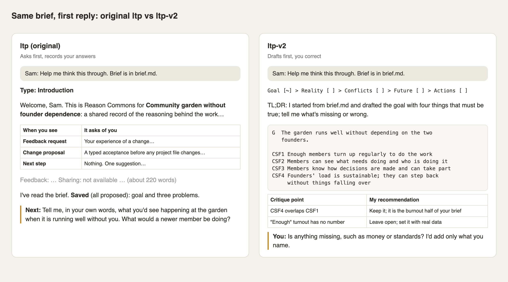

There is now an experimental [`ltp-v2` skill](/skills#try-the-faster-version-ltp-v2) alongside `ltp`. Instead of building up a goal one question at a time, it drafts it straight away from your notes or a short description, then works through problems, conflicts and actions in a fixed order. It critiques its drafts before showing them, pushes back on your edits, shows trees as plain text that fits a chat window, and keeps a readable summary next to its saved state.

Install it with `npx skills add reasoncommons/reasoncommons -s ltp-v2` (keep `ltp` installed too) and call it with `/ltp-v2`. The skill itself is [skills/ltp-v2/SKILL.md](https://github.com/reasoncommons/reasoncommons/blob/main/skills/ltp-v2/SKILL.md). The original `ltp` is unchanged. For how the two compare on the same problem, see [Drafting first vs asking first](/blog/ltp-v2-side-by-side).
